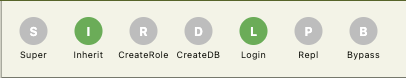

## Users and Roles
```
Although technically correct, the explanation below is an oversimplification of the reality of PostgreSQL roles.
More information can be found here: https://www.postgresql.org/docs/current/user-manag.html
```

PostgreSQL does not have separate **users** or **groups** at the catalog level.  
Instead, it uses the concept of **roles**, which have attributes and privileges and can be granted to other roles.

PostgreSQL prevents circular inheritance of roles. If role A inherits role B, and role B inherits role A, then PostgreSQL will throw an error.

The following things can be assigned to roles:

### 1. Role Attributes, Constraints and Security Labels

Each role has eight attributes:
- Superuser
- Inherit
- Create Role
- Create DB
- Login
- Replication
- Bypass RLS
- Password

When a user is selected on the left side of the screen, their attributes are shown at the top of the right pane:  
  
The application's primary theme color (green by default) indicates that an attribute is set, while grey indicates it is not set.

The `Login` attribute determines if a role can log in to the database. This defines the distinction in this application:
- If `Login` is true, it is a **User** and appears on the **left**
- If `Login` is false, it is a **Role** and appears on the **right**

Throughout the application and documentation, objects on the left (`rolcanlogin = true`) are **Users**, and objects on the right (`rolcanlogin = false`) are **Roles**.

Attributes are **not** inherited by child roles. If a role called `DBAs` has the Superuser attribute set to **true**, members of that role are **not** superusers. If the `SET` option is true they can become Superuser however, see the section on [Granting](#granting).

Users and roles can have constraints by setting a `CONNECTION LIMIT` or a `VALID UNTIL` attribute (used for password expiration and automated grouping of expired users).  
They can have security labels (MAC/SELinux) by applying a `SECURITY LABEL` or `COMMENT`.

### 2. Object-Level Privileges
There are many different privileges on many different objects.  
The most important ones are:
- SELECT
- INSERT
- UPDATE
- DELETE

These privileges **are** inherited.  
So if a role called `hr` can SELECT, INSERT and UPDATE on table `hr.persons` then
any user that is a member of `hr` can also SELECT, INSERT and UPDATE on `hr.persons`.

Many organizations use this feature to create a system where privileges are granted to roles and users become members of these roles.
Thereby inheriting the privileges of the roles.

Access privileges can be **GRANT**ed and **REVOKE**d on roles for: tables (or [materialized] views), columns, sequences, databases, domains, foreign data wrappers, servers, routines, languages, large objects, configuration parameters, schemas, tablespaces, types and other roles. [*grant*](https://www.postgresql.org/docs/current/sql-grant.html) / [*revoke*](https://www.postgresql.org/docs/current/sql-revoke.html)

<!--
### 03. RLS Policies
```sql
CREATE POLICY policy_name ON table_name 
TO role_name [, ...] 
USING (...) WITH CHECK (...);
```
Policies can also be assigned to roles.
They can be permissive or restrictive.


### 04. Runtime Configuration Settings (GUC Parameters)


### 05. Predefined System Roles


### 06. Object Ownership
Objects have owners. The owner of an object has all privileges on that object.
-->
## Granting
When you grant a role to a user, for example: `grant hr to karen;`
You have three options:
- ADMIN; the user will be able to grant this privilege to other users. Or drop the `hr` role altogether.
- INHERIT; the user can SELECT, UPDATE, INSERT and DELETE any object that the `hr` role can access.
- SET; the user can use the attributes of the `hr` role. Such as BYPASSRLS by using `set role hr`

Role attributes (SUPERUSER, INHERIT, BYPASSRLS etc.) are not inherited. They can only be obtained by switching to that role using `set role <role_name>`. This program uses the default values from PostgreSQL; ADMIN=false, INHERIT=true, SET=true.

## Extra
If you are going to make a user a member of a role, for example: `grant hr to karen;`
Then you must have ADMIN rights on `hr`. Not per se on `karen`.

The query to select the users is:
```sql
WITH me AS (
    SELECT 
        current_setting('is_superuser') = 'on' AS is_super,
        rolcreaterole AS can_create
    FROM pg_catalog.pg_roles
    WHERE rolname = CURRENT_USER
),
user_roles AS (
    SELECT
        r.oid::int,
        r.rolname AS name,
        r.rolsuper AS is_superuser,
        r.rolinherit AS inherit,
        r.rolcreaterole AS create_role,
        r.rolcreatedb AS create_db,
        r.rolcanlogin AS can_login,
        r.rolreplication AS replication,
        r.rolbypassrls AS bypass_rls,
        (CURRENT_USER = r.rolname) AS is_current,
        pg_catalog.shobj_description(r.oid, 'pg_authid') AS description,
        (
            me.is_super
            OR EXISTS (
                SELECT 1 FROM pg_catalog.pg_auth_members m
                WHERE m.roleid = r.oid
                  AND m.member = CURRENT_USER::regrole::oid
                  AND m.admin_option = true
            )
        ) AS is_admin,
        CASE
            WHEN r.rolvaliduntil IS NOT NULL AND isfinite(r.rolvaliduntil)
            THEN to_char(r.rolvaliduntil, 'YYYY-MM-DD')
        END AS valid_until,
        (r.rolvaliduntil IS NULL OR r.rolvaliduntil > CURRENT_TIMESTAMP) AS is_valid,
        (
            r.rolvaliduntil IS NOT NULL
            AND isfinite(r.rolvaliduntil)
            AND r.rolvaliduntil > CURRENT_TIMESTAMP
            AND r.rolvaliduntil <= CURRENT_TIMESTAMP + INTERVAL '7 days'
        ) AS is_expiring_soon,
        me.is_super,
        me.can_create
    FROM pg_catalog.pg_roles r
    CROSS JOIN me
    WHERE r.rolcanlogin
)
SELECT
    oid,
    name,
    is_superuser,
    inherit,
    create_role,
    create_db,
    can_login,
    replication,
    bypass_rls,
    is_current,
    description,
    is_admin,
    (is_admin AND (is_super OR can_create)) AS can_drop,
    valid_until,
    is_valid,
    is_expiring_soon
FROM user_roles
ORDER BY is_valid DESC, LOWER(name) ASC;
```

The query to select the roles catalog is:
```sql
SELECT 
    g.oid::int,
    g.rolname AS name,
    pg_catalog.shobj_description(g.oid, 'pg_authid') AS description,
    '{}'::text[] AS grantors,
    (COALESCE(bool_or(me.admin_option), false) OR current_setting('is_superuser') = 'on') AS grantable,
    false AS granted,
    NULLIF(
        btrim((
            SELECT substring(cfg FROM '^dbroles\.category=(.*)$')
            FROM unnest(g.rolconfig) AS cfg
            WHERE cfg LIKE 'dbroles.category=%'
            LIMIT 1
        )),
        ''
    ) AS category
FROM pg_catalog.pg_roles g
LEFT JOIN pg_catalog.pg_auth_members me
    ON g.oid = me.roleid
   AND me.member = CURRENT_USER::regrole::oid
   AND me.admin_option = true
WHERE NOT g.rolcanlogin
GROUP BY g.oid, g.rolname, g.rolconfig
ORDER BY
    (CASE 
        WHEN split_part(
            NULLIF(btrim((
                SELECT substring(cfg FROM '^dbroles\.category=(.*)$')
                FROM unnest(g.rolconfig) AS cfg
                WHERE cfg LIKE 'dbroles.category=%'
                LIMIT 1
            )), ''),
            ':', 2
        ) ~ '^[0-9]+$'
        THEN split_part(
            NULLIF(btrim((
                SELECT substring(cfg FROM '^dbroles\.category=(.*)$')
                FROM unnest(g.rolconfig) AS cfg
                WHERE cfg LIKE 'dbroles.category=%'
                LIMIT 1
            )), ''),
            ':', 2
        )::int
    END) ASC NULLS LAST,
    LOWER(NULLIF(
        split_part(
            btrim((
                SELECT substring(cfg FROM '^dbroles\.category=(.*)$')
                FROM unnest(g.rolconfig) AS cfg
                WHERE cfg LIKE 'dbroles.category=%'
                LIMIT 1
            )),
            ':', 1
        ),
        ''
    )) ASC NULLS LAST,
    LOWER(g.rolname) ASC;
```

The query to fetch a user's role memberships (and track grantors) is:
```sql
SELECT
    m.roleid::int,
    COALESCE(bool_or(m.grantor = CURRENT_USER::regrole::oid), false) AS granted,
    COALESCE(
        array_agg(m.grantor::regrole::text ORDER BY m.grantor::regrole::text)
        FILTER (WHERE m.grantor IS NOT NULL AND m.grantor <> CURRENT_USER::regrole::oid),
        '{}'::text[]
    ) AS grantors
FROM pg_catalog.pg_auth_members m
WHERE m.member = $1::oid
GROUP BY m.roleid;
```

## UI Action Visibility & Permission Rules

The application determines which actions and settings are visible based on the privileges of the connected user (`CURRENT_USER`) and the properties of the selected **User** or **Role**:

### 1. Create User (`+` FAB)
- **Visible when**: The connected account has the `CREATEROLE` attribute (`rolcreaterole = true`).

### 2. Edit User (AppBar Edit Icon)
- **Visible when**:
  1. The connected account has the `CREATEROLE` attribute (`_canCreateRole = true`).
  2. The connected account has `ADMIN OPTION` on the selected user (`user.isAdmin = true`).

### 3. Duplicate User (AppBar Duplicate Icon)
- **Visible when**:
  1. A user is selected.
  2. The connected account has the `CREATEROLE` attribute (`_canCreateRole = true`).
- **Behavior**:
  - Pre-populates the new user's username with `<name>_copy`, along with the original user's description, attributes, and password expiration date (`VALID UNTIL`).
  - Displays all roles currently assigned to the source user, with grantable roles pre-selected, allowing the admin to easily customize which role memberships are copied to the new user.

### 4. Delete User (AppBar Delete Icon)
- **Visible when all three conditions are met**:
  1. **PostgreSQL Entitlement (`user.canDrop = true`)**: The connected account has `CREATEROLE` **and** `ADMIN OPTION` on the selected user (`is_admin AND (is_super OR can_create)`).
  2. **No Elevated Attributes**: The selected user does **not** have any special privileges (`!isSuperuser`, `!createRole`, `!createDb`, `!replication`, `!bypassRls`).
  3. **No External Grantors**: None of the selected user's assigned roles were granted by another grantor (`grantors.isEmpty`).

### 5. Grant / Revoke Role (Role Checkbox)
- **Enabled when**: The connected account has `ADMIN OPTION` on that role (`group.grantable = true`).

### 6. Role Categories Management & Assignment (`dbroles.category`)
- **Centralized Management in App Settings ("Role Categories" Tab)**:
  - Accessible in App Settings under a dedicated **Role Categories** tab when the connected account has `SET` privilege on `dbroles.category` (`has_parameter_privilege('dbroles.category', 'SET') = true`).
  - To grant this privilege to the `dbroles` admin account, run as a superuser:
    ```sql
    GRANT SET ON PARAMETER dbroles.category TO dbroles;
    ```
  - **Clean Role View**: Role rows on the main user membership page (`RoleManagementWidget`) remain uncluttered and focused strictly on granting/revoking roles for users.
  - **Drag-and-Drop Reordering**: Categories can be dragged and reordered directly in Settings. Reordering automatically assigns the new 1-based numeric sort order (`1`, `2`, `3`...) and updates `dbroles.category` across all member roles in PostgreSQL.
  - **Category Editing & Role Assignment (✎)**:
    - Edit category name and color.
    - Choose which roles belong to the category directly in the dialog via a searchable, virtualized checkbox list supporting 100+ groups smoothly.
    - The search box filters by both role name and description (e.g. searching for "country" matches roles with "country" in their comment/description).
    - Quick filter segments: `All`, `In Category`, and `Ungrouped`, with "Select All" / "Deselect All" bulk actions.
    - Roles newly selected are updated to the category in batch; unselected roles have their category cleared in batch.
  - **Global Category Deletion (🗑)**: Deleting a category prompts for confirmation and clears `dbroles.category` on all member roles (`ALTER ROLE <role> RESET dbroles.category`), returning them to Ungrouped.
  - **New Category (+)**: Allows creating a new category with color presets and immediately selecting member roles.
- **Extended Category Format (`name[:order[:color]]`)**:
  - Categories support an optional numeric sort order and hex color, e.g. `department:1:34BB22` or `country:2:88AA00`.
  - Roles are sorted in PostgreSQL by custom numeric order first (`ASC NULLS LAST`), then category name alphabetically, then role name.
  - Section headers display category color accents and count badges.

### 7. Attribute Assignment & Superuser Safety Rules
- **No Superuser Connections**: Superusers are prohibited from connecting with this application. On connection, if `current_setting('is_superuser') = 'on'` is detected, the application blocks regular operation with a warning (*"Superuser connection detected. Please setup a Role Admin."*) and directs the user to connection settings.
- **Ceiling on Role Attributes**: In PostgreSQL, a non-superuser with `CREATEROLE` can **only** assign attributes (`CREATEROLE`, `CREATEDB`, `REPLICATION`, `BYPASSRLS`) to new or duplicated roles if they **themselves** possess that exact attribute. Non-superusers can **never** assign `SUPERUSER`.


---
